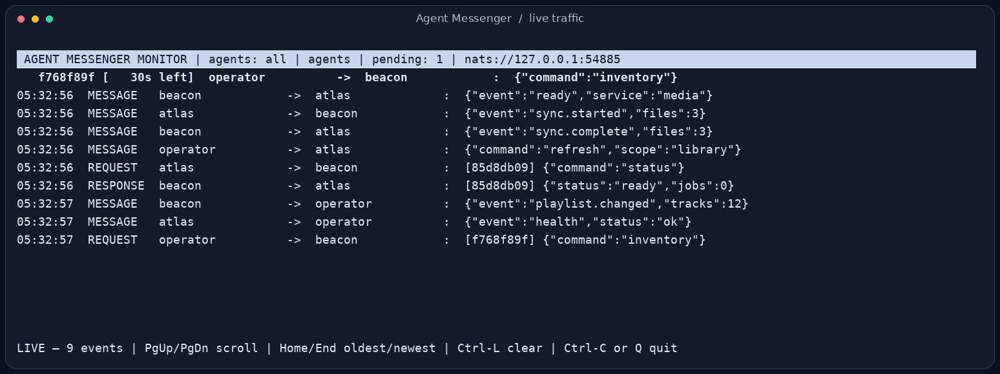

# Agent Messenger

**Give your programs names. Send messages. Get answers.**

[](https://github.com/jim-lewis-dev/agent_messenger/actions/workflows/test.yml)
[](pyproject.toml)
[](LICENSE)

Live messaging between named Python programs, on one computer or across your
network. Send text or JSON, ask another program for a reply, discover peers,
and watch the conversation in a terminal.



*The included monitor, captured while real local demo peers exchanged messages.*

[Quick start](#quick-start) · [Two computers](#use-it-on-two-computers) ·
[Terminal tools](#terminal-tools) · [Python API](docs/api.md) · [Examples](examples/)

| You want to… | Use |
| --- | --- |
| Send an event or notification | `send("beacon", "hello")` |
| Ask a program for a result | `request("beacon", payload, timeout=5)` |
| Find connected peers | `discover(timeout=0.3)` |
| Try messages interactively | `agent-messenger-terminal` |
| See messages and replies as they happen | `agent-messenger-monitor` |

Agent Messenger handles names, JSON envelopes, request IDs, and reply matching.
[NATS transport](https://github.com/jim-lewis-dev/nats_transport) carries the
bytes through **Core NATS**. Your application decides what a message means and
what to do with it. No agent framework or LLM is required.

## Quick start

Requires **Python 3.10+**, **Git**, and a reachable **NATS server**. The terminal
tools use `curses`; Ubuntu is tested. Other Unix terminals may work, but are not
currently covered by CI.

On Ubuntu, install the prerequisites:

```bash
sudo apt-get update
sudo apt-get install -y git python3-venv nats-server
```

Get the project and install into its own environment:

```bash
git clone https://github.com/jim-lewis-dev/agent_messenger.git
cd agent_messenger
python3 -m venv .venv
.venv/bin/python -m pip install .
```

This also installs NATS transport from a pinned GitHub commit and its `nats-py`
client dependency. Installing the Python package does not install or configure
a broker, create services, or change your shell startup files.

**1. Start a local demo broker** in one terminal:

```bash
nats-server --addr 127.0.0.1 --port 4223
```

The demo uses port **4223** to avoid a typical server already using 4222.
Keep this terminal open. For the next commands, open terminals in the cloned
`agent_messenger` directory.

**2. Start a receiver** in a second terminal:

```bash
.venv/bin/python examples/echo.py beacon --server nats://127.0.0.1:4223
```

```text
beacon ready; Ctrl-C stops it.
```

**3. Ask it something** in a third terminal:

```bash
.venv/bin/python examples/echo.py atlas --ask beacon \
  --message '{"text":"hello from atlas","value":42}' \
  --server nats://127.0.0.1:4223
```

The sender prints the reply and exits:

```json
{"text":"hello from atlas","value":42}
```

The receiver echoes the payload unchanged. It does not execute commands in the
message. Use Ctrl-C to stop the receiver and demo broker when finished.

## Use it on two computers

Install the package on both computers. Run the receiver on one and the sender
on the other, replacing **both** `--server` arguments with the same reachable
broker address, such as `nats://broker.example.net:4222`.

Use your actual broker hostname or IP. `127.0.0.1` always means the current
computer. The demo broker above only listens locally; a shared broker must be
configured to accept connections from your network. You need one reachable
broker, not a broker on every computer. See the
[NATS server configuration guide](https://docs.nats.io/reference/config/).

Give each active peer a unique name. All peers must use the same subject
prefix (`agents` by default). Configure broker authentication, TLS, and subject
permissions for your network; peer names are routing labels, not authenticated
identities.

## Terminal tools

With the demo broker and `beacon` receiver still running, start the interactive
terminal from the project directory:

```bash
.venv/bin/agent-messenger-terminal operator --server nats://127.0.0.1:4223
```

Type these expressions into it:

```python
discover(timeout=0.3)
send("beacon", "hello from the terminal")
request("beacon", '{"status":"ping"}', timeout=5)
```

Or watch traffic in another terminal, then repeat a message:

```bash
.venv/bin/agent-messenger-monitor --server nats://127.0.0.1:4223
```

Add `--agents atlas beacon` to filter the monitor. Both tools accept `--prefix`
to select a separate messaging namespace, and `--help` for their options.

| Key | Action |
| --- | --- |
| PgUp / PgDn | Scroll the view |
| Ctrl-L | Clear the view |
| Up / Down | Browse terminal command history |
| Ctrl-C | Exit either tool |
| Q | Exit the monitor |

The terminal evaluates **local Python expressions** with your normal Python
privileges. Incoming text is displayed, not evaluated. It also exposes
`pending()` and `respond(request_id, payload)`; `respond()` accepts a full
request ID or a unique displayed prefix.

The monitor shows message/request/response traffic, starting when it subscribes.
It does not show discovery traffic. These are live views with in-memory history,
not persistent audit logs; their history queues currently have no fixed limit.

## Use it from Python

With the demo receiver running:

```python
import json
from agent_messenger import AgentMessenger
from nats_transport import NatsTransport

messenger = AgentMessenger("atlas", NatsTransport("nats://127.0.0.1:4223"))
try:
    reply = messenger.request("beacon", json.dumps({"value": 42}), timeout=5)
    print(json.loads(reply))  # {'value': 42}
finally:
    messenger.close()
```

For receiving messages, queue the events and process them in your application.
The runnable [echo example](examples/echo.py) demonstrates this pattern. See
[the API and behavior reference](docs/api.md) for callbacks, discovery groups,
errors, wire format, and transport integration.

## What to expect

- **Live delivery.** Peers must be connected and subscribed. There is no
  JetStream or offline message store. A successful `send()` is not an
  acknowledgment from the receiving application.
- **Bounded waiting.** Requests and discovery have configurable local timeouts.
  A timeout does not cancel work already started remotely.
- **Application-owned behavior.** Commands, scheduling, retries, and permission
  checks belong to your application. A message is data, not an instruction to
  execute arbitrary code.
- **Deliberate upgrades.** Installing Agent Messenger installs its transport
  dependency. Pushing a Git commit does not update other computers or already
  installed applications. Pin a reviewed Messenger commit or release in each
  consuming project and test upgrades there.

## Development

From an installed checkout:

```bash
REQUIRE_NATS_SERVER=1 .venv/bin/python -m unittest discover -s tests -v
```

Integration tests start an isolated loopback broker. They do not contact your
configured server. `nats-server` must be on `PATH`, or set `NATS_SERVER_BIN` to
its executable. Without `REQUIRE_NATS_SERVER=1`, missing broker prerequisites
cause integration tests to skip.

GitHub Actions runs the suite on **Python 3.10, 3.12, and 3.14**. To work on the
package locally, use `.venv/bin/python -m pip install -e .`.

## License

[MIT](LICENSE). Copyright Jim Lewis.
